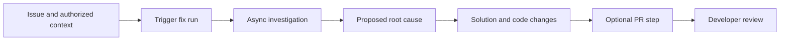

# Seer user journeys

Research date 2026-11-04. Documentation-derived unless explicitly identified as a browser observation. No production account was connected.

## Discovery

**CONFIRMED — observed:** public page → product headline and feature links → sandbox/signup/docs links and demo iframes. The first embedded demo displayed “1/4” and a claim about automatically drafting fixes for certain issues. An attempted click of its first hotspot timed out and did not advance, so subsequent demo states were not observed. [Source](https://sentry.io/product/seer/).

## Issue fix (documented API workflow)

**CONFIRMED:** The [start endpoint](https://docs.sentry.io/api/seer/start-seer-issue-fix/) supports root-cause, solution, code-changes and PR-opening stopping points; with no stopping point specified it runs to root cause. It requires authenticated write scope. Existing runs can be continued and optional user context provided. The [state endpoint](https://docs.sentry.io/api/seer/retrieve-seer-issue-fix-state/) describes status, progress, root cause, solution and changes. This is an API capability description, not proof that every UI flow behaves identically. The docs list `pr_iteration`; the precise CI-failure behavior is **UNKNOWN**.

**UNKNOWN:** Which approval actions are mandatory under every configuration, whether test execution or failure reproduction is required for a PR, and exact user-facing failure states. A vendor example exposes an `autoOpenPrs` setting, so do not assert that every PR requires a separate approval click ([organization API](https://docs.sentry.io/api/organizations/update-an-organization/)).

## Setup and agent entry

**CONFIRMED — vendor description:** public page describes enabling generative AI, connecting source context and using automatic issue fixing; page says a paid plan or trial can enable Seer. [Project repository API](https://docs.sentry.io/api/projects/add-repositories-to-seer-for-a-project/) documents repository configuration and authorization scopes. The product page advertises plain-language Agent questions and Slack integration; these were not exercised. Requirements vary by workflow; no external account was connected.
