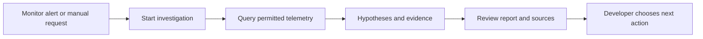

# Observable workflow research

Accessed 2026-11-04. Evidence labels: CONFIRMED = direct official documentation or observed page; INFERRED = reasoned interpretation; UNKNOWN = not verified. Public pages are vendor claims, not independent accuracy evaluations.

## Public discovery observed with Playwright

**CONFIRMED (direct observation):** Playwright navigated to [Sentry Seer](https://sentry.io/product/seer/) and returned an accessibility snapshot. The page presents Agent, Autofix, and AI Code Review links; cookbook links include investigation, Slack, MCP and GitLab; calls to action include free signup and demo. A video play control is present. No account was connected, product investigation started, demo played, or PR created. The marketing claims shown on the page do not independently verify their effectiveness.

## Documentation-derived workflows

| Product | Entry → action → response → evidence → decision → outcome | Source and limitation |
|---|---|---|
| Datadog | Alert or manual request → investigation → findings → telemetry and linked source context → inspect/act → report, optionally integrated into notification destinations. GitHub integration plus APM git tags connect deployed versions; source access enables Bits Code fixes. | [Bits integrations](https://docs.datadoghq.com/bits_ai/bits_investigation/configure/); documentation only; availability varies by site. |
| Grafana | Workspace prompt or configured alert → cross-signal investigation → hypothesis plan and report → source chips open the query and time range → user confirms, disproves or reopens hypothesis → report or continued investigation. | [Assistant investigations](https://grafana.com/docs/grafana-cloud/platform/grafana-assistant/platform/investigation/); documented, not interacted with. Assistant queries with the user's permissions. |
| Dynatrace | Problem → topology-based root-cause evaluation → highlighted implicated entities → inspect causal context → responder chooses action. | [Root cause analysis](https://docs.dynatrace.com/docs/dynatrace-intelligence/root-cause-analysis); details and interactive states unverified. |
| Resolve AI | Incident → investigation → proposed root-cause context → responder reviews → follow-up. | [AI SRE](https://resolve.ai/product/ai-sre); marketing, not a tested run. |
| New Relic | Incident → Autopilot investigation → diagnosis/recommendation using telemetry → user reviews and acts. | [Autopilot overview](https://docs.newrelic.com/docs/agentic-ai/autopilot/overview/); no live run. |

**UNKNOWN:** Full Seer authenticated onboarding, permission consent screens, CI failures and resulting PR states were not observed. Integrations and service availability depend on plan and account. Do not infer a feature is absent from the lack of a live demonstration.
