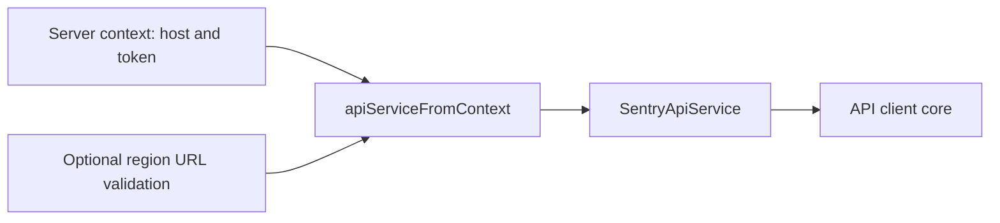

# Dependency graphs and limits

2026-11-04. **CONFIRMED:** ran `graphify update` against the `packages/mcp-core` subtree of a shallow local clone of [sentry-mcp](https://github.com/getsentry/sentry-mcp/tree/b8c480fc09c6ef2fbab337c1027705955d255456/packages/mcp-core), followed by `graphify query 'How do Sentry MCP tools call the API and manage authentication?' --budget 1000`. AST-only extraction reported 431 files, 3,186 nodes, 9,155 edges and 155 communities; 71 files yielded no symbols. Semantic extraction was not performed, so these figures are extraction artifacts, not architectural quality metrics. Graphify identified the following call and direct source inspection verified the helper's arguments:

**UNKNOWN:** graph edges do not prove runtime reachability, complete authorization, or network topology. The graph is scoped to one package, not all Sentry, Relay or the hosted product. It lives in a temporary checkout rather than the deliverables. No graphs were generated for the other repositories; dedicated, version-pinned analyses remain future work. [Collector architecture](https://opentelemetry.io/docs/collector/architecture/) independently supports the telemetry pipeline, not a Sentry dependency graph.
