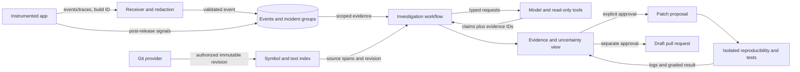

# Proposed system architecture

All components and edges below are **PROPOSED**, not observations of Sentry's internals. The pipeline shape is informed by [OpenTelemetry](https://opentelemetry.io/docs/collector/architecture/) and the API boundary in [sentry-mcp](https://github.com/getsentry/sentry-mcp/blob/b8c480fc09c6ef2fbab337c1027705955d255456/packages/mcp-core/src/internal/tool-helpers/api.ts#L19).

Persist incident identity, source revision, evidence provenance, tool calls, model version, state transitions and verification artifacts. The worker must enforce tenant boundaries and scoped read credentials independently of model output. Model-produced patches never directly mutate the source repository; validate in a disposable environment and gate PR creation. Handle duplicate events idempotently, queue saturation with explicit drops and retries, missing source maps as missing evidence, and deletion/retention across derived indexes. Prioritize a single language and event source for MVP. No 3D visualization is required for correctness.
