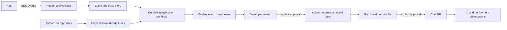

# Product blueprint — proposed, not implemented

**Vision (hypothesis):** Help individual developers and small teams move from a real incident to an evidence-backed explanation and a reviewable repair, without hiding uncertainty. Competitive differentiation and willingness to pay remain unvalidated.

All components are proposed; details in architecture and evaluation reports. Telemetry and source are untrusted; secrets do not enter model context by default. AI proposes hypotheses and changes; deterministic services enforce permissions, record artifacts and run checks. No generated explanation is a verified root cause without corroboration.

| Feature | Journey and data | AI / deterministic responsibility | Acceptance and failure states | Difficulty |
|---|---|---|---|---|
| Repository connection | User grants selected repository read access; pin commit. | Index symbols and search; AI selects relevant evidence. | Revocation works; citations resolve to exact commit; missing access is explicit. | Medium |
| Incident intake | SDK sends exception, trace and release metadata. | Validate, deduplicate, redact; no AI needed. | Reject malformed input; preserve timestamps and provenance; show missing data. | Medium |
| Investigation | User opens incident; compare plausible causes with code and runtime evidence. | AI proposes explanations; system records evidence and limitations. | Every material claim links evidence; abstain on insufficient data. | High |
| Proof-of-fix | User approves isolated reproduction and patch proposal. | Runner reproduces, AI drafts patch, runner tests with no production credentials. | Show generated, checks passed, reproduced and resolved, production confirmed as distinct states. Failed and inconclusive tests remain visible. | Very high |
| Draft PR | Developer reviews diff and authorizes PR creation. | Deterministic integration applies scoped credentials and logs action. | Show base commit, diff, results and limitations; no merge or deployment automatically. | Medium |
| Journey monitoring | User defines safe synthetic test against authorized environment. | Playwright executes; AI may explain evidence. | Distinguish environment failure from user-journey failure; no claims of real user experience. | High |
| Dependency map | User explores relationships backed by index and runtime links. | Deterministic graph; AI explains selected edge. | Every edge names origin and confidence; missing edges are not proof of absence. | Medium |

See roadmap and PRD for gates; source references and unresolved questions are recorded separately.
