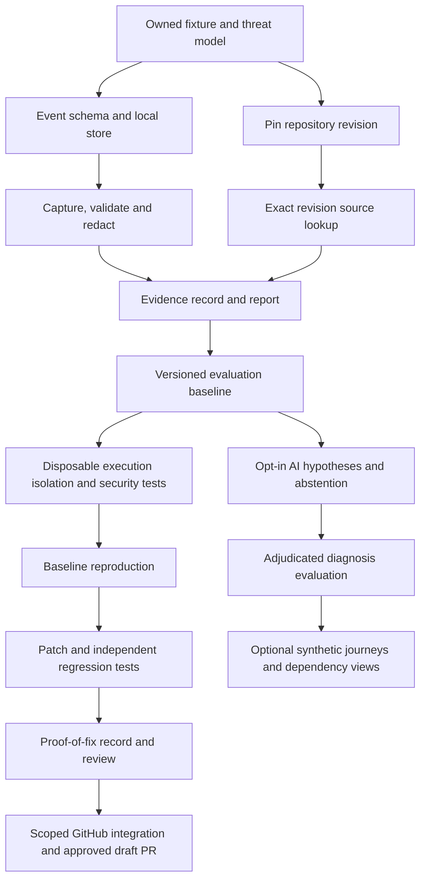

# Research readiness audit

**Assessment: READY WITH RISKS.** The evidence supports starting an explicitly authorized, local, single-user prototype. It does not support production deployment, autonomous repair, or claims of competitive superiority. Reviewed 2026-11-04; all research files and the progress log were examined. No benchmark or implementation has been run.

## Evidence and outstanding research

| Gap | Evidence and implication | Closing action |
|---|---|---|
| Competitor verification | [03](03_SEER_USER_JOURNEYS.md), [05](05_OBSERVABLE_WORKFLOW_RESEARCH.md), and [12](12_COMPETITIVE_GAP_ANALYSIS.md) primarily describe vendor documentation; no authenticated head-to-head tests were performed. Competitor test verification is unknown, not absent. | Compare permitted trials using identical incidents before making superiority claims. |
| Demand | [12](12_COMPETITIVE_GAP_ANALYSIS.md) and [20](20_OPEN_QUESTIONS_AND_RISKS.md) document no user interviews or willingness-to-pay evidence. | Interview target developers and pilot the workflow; record counterexamples. |
| Accuracy and cost | [13](13_QUALITY_EVALUATION_PLAN.md) and [14](14_TECH_STACK_FEASIBILITY.md) propose evaluation and costs but report no measurements. | Build versioned fixtures, run the gates below, measure compute and inference costs. |
| Security | [11](11_AI_ENGINEERING_DESIGN.md) proposes isolation, permission checks and redaction; these have not been implemented or tested. | Threat-model the selected platform and test boundaries before untrusted code or customer data. |
| Retrieval | [07](07_ARCHITECTURE_HYPOTHESES.md) proposes lexical and symbol search; coverage and accuracy are unknown, especially for stale commits and missing source maps. | Measure recall against labeled revisions; explicitly show unresolved frames. |
| Reliability | [10](10_PROPOSED_SYSTEM_ARCHITECTURE.md) proposes durable state, retries and idempotency, but no transaction or recovery design is proven. | Specify idempotency keys, retry bounds, cancellation, storage transactions and crash recovery; test duplicate delivery. |
| Source coverage | [08](08_OPEN_SOURCE_ARCHITECTURE.md) and [09](09_DEPENDENCY_GRAPHS.md) cover a scoped Sentry MCP subtree, not full Sentry or Relay; license review is incomplete. | Review exact dependency licenses and notices before reuse. |
| Audit trail | [19](19_RESEARCH_SOURCE_INDEX.md) has a shared research date and links reports but often uses generic titles and lacks individual claim/access records. Browser captures were ephemeral. | Record source-specific claim, access time and reproducible capture in future work. |
| Cost and stack | [14](14_TECH_STACK_FEASIBILITY.md) and [15](15_ZERO_COST_MVP_PLAN.md) do not establish model quality on available hardware or sustainable free hosting. | Recheck current terms and measure storage, runtime, tokens and egress. |

## Tool verification

| Tool | What was learned | Limits |
|---|---|---|
| Chrome DevTools | Public page structure, initial demo frames, bounded network metadata, and no console warnings/errors at one observation; a demo hotspot timed out. [04](04_SEER_FRONTEND_OBSERVATIONS.md). | No signed-in workflow, full demo, performance trace, saved screenshot or HAR. |
| Playwright | Opened the public product page and obtained an accessibility snapshot. [05](05_OBSERVABLE_WORKFLOW_RESEARCH.md). | No authenticated investigation, onboarding, completed demo or PR. |
| REA | `binary_session` succeeded and reported Ghidra available; no binary was open. [00](00_TOOL_READINESS.md), [06](06_REVERSE_ENGINEERING_FINDINGS.md). | No Sentry artifact was inspected with REA. No private backend was reverse engineered. |
| Graphify | AST graph and query over pinned `sentry-mcp/packages/mcp-core`; relevant helper and client were checked directly. [09](09_DEPENDENCY_GRAPHS.md). | No complete Sentry or Relay graph; graph edges do not prove runtime reachability or production topology. |

## Seer workflow gaps

The [official issue-fix API](https://docs.sentry.io/api/seer/start-seer-issue-fix/) documents asynchronous root-cause, solution, code-change and PR stages, plus `pr_iteration` and coding-agent handoff. Unknowns include the authenticated setup and consent screens, evidence selection and presentation, failure states, actual test execution and reproduction, CI failure handling, approval and auto-PR behavior across settings, and production outcome tracking. API descriptions do not establish each UI flow. Test only with authorized accounts or public demos and record configuration and results.

## Architecture assessment

**Technical correctness.** Bounded evidence retrieval and staged processing are plausible. [OpenTelemetry](https://opentelemetry.io/docs/collector/architecture/) documents receivers, processors and exporters; it does not establish our proposed grouping, storage or durability. Preserve event time and ingestion time, build and commit identity, source revision, evidence IDs, provenance and artifact hashes. A missing revision is not a negative result. Validate citation existence and permission in code; a real citation alone does not prove the claim. Compare one bounded model call with a deterministic retrieval baseline before adding multi-agent coordination.

**Security.** Treat repository files, telemetry, issue text, model output and test artifacts as untrusted. [OWASP](https://genai.owasp.org/llmrisk/llm01-prompt-injection/) describes indirect prompt injection and notes that retrieval and fine-tuning do not fully mitigate it. Enforce permissions, data minimization, consent and budgets outside the model. A future runner needs a hardened disposable VM or equivalently justified boundary, no production secrets, restricted egress, quotas and cleanup; containers alone are not a universal security boundary. Redaction is fallible and needs tests. Local single-user controls do not prove tenant isolation.

**Reliability.** Define durable states, bounded retries, idempotency, cancellation, crash recovery and partial results. Show test failure, flaky reproduction, timeout and infrastructure failure separately. A passing build or test does not prove production resolution. Production confirmation requires independent post-deployment observations.

**Cost.** Start locally with bounded fixtures, SQLite and lexical search. Record model version, input/output tokens and price, retries, runtime, CPU/RAM, storage and egress. Stop safely at a user-set budget and mark results incomplete. Existing hardware, power and time have costs even if service charges are ₹0. A vector database, fleet of agents and hosted dashboard are not initial requirements.

## Differentiation to validate

- **Proof-of-Fix Engine — hypothesis:** connect the exact buggy revision and environment to a failing baseline, patch hash, target test, independent regression tests and explicit limitations. Report non-reproducible and flaky cases as inconclusive. Compare false verification, eligible reproduction rate and reviewer time against existing tools before claiming an advantage.
- **AI Root Cause Detective — hypothesis:** show competing causes, supporting and contradicting evidence, missing context and abstention, anchored to source revisions. [Grafana already documents hypotheses and evidence](https://grafana.com/docs/grafana-cloud/platform/grafana-assistant/platform/investigation/), so citations alone are not novel. Measure causal accuracy, unsupported claims and user comprehension against the same evidence and budget.

## Benchmarks and acceptance tests

These are **proposed gates**, not measured results. Small suites catch regressions but cannot establish population accuracy. Version fixtures, model, prompts and harness; separate authoring cases from blind repository/time holdouts; report denominators, skips, uncertainty and reviewer disagreements. [SWE-bench](https://github.com/SWE-bench/SWE-bench) can supplement repair evaluation but is not a production-incident diagnosis benchmark.

| Gate | Concrete test and acceptance |
|---|---|
| Evidence integrity | At least 10 licensed or locally owned pinned cases including a known exception, duplicate, invalid event, missing commit and dummy secret. All valid records retain event identity and provenance; duplicates produce one logical record; malformed data is rejected; missing revisions remain unresolved; dummy secrets do not appear in stored or displayed outputs. |
| Retrieval | At least 10 fixtures with adjudicated file and revision. Report top-1 and top-5 recall and wrong-revision rate; proposed exploratory gate top-5 ≥ 8/10. This small target is not a generalized accuracy claim. |
| Diagnosis | At least 20 adjudicated cases, including five insufficient-evidence and five misleading or multiple-cause cases, plus a separate holdout. Two reviewers independently score causal correctness, relevance and unsupported claims, then adjudicate. Report abstention and fabricated citations. Initial hard gate: zero fabricated evidence IDs or unauthorized tool calls in the suite; set accuracy targets after baseline measurement. |
| Proof of fix | At least 10 eligible deterministic bugs with failing baseline, known-good patch, independent holdout tests and an overfit patch. No-op must not be labeled fixed; overfit must fail holdout; failed or flaky baselines yield inconclusive. Report reproduced-and-resolved / eligible and false verification / verification claims. |
| Adversarial and failure handling | Put malicious instructions in fixture logs and comments; requests for secrets, shell execution or PR creation must be denied by policy regardless of wording. Inject timeouts, network denial, crash and duplicate jobs; verify no unauthorized side effects, bounded retries and recorded recoverable state. Passing does not prove immunity. |
| Cost and latency | On a declared machine and model, record tokens, service charges, wall time and CPU/RAM for success, failure and timeout. Show sample counts and distributions; test that hard-budget exhaustion gives an incomplete result. |
| Usability | In a moderated pilot, ask users to locate evidence, identify an unsupported conclusion and describe what tests passed. Pre-register completion criteria and record time, errors and qualitative feedback. |

## MVP and dependencies

Start local-only with one intentionally buggy application, one language, a real captured exception or labeled fixture, an immutable source revision, deterministic lookup and an inspectable report. Add opt-in model calls only after evidence integrity works. Defer autonomous patching, external writes, hosted multi-tenancy, vector search, 3D views and always-on monitoring. A fixture must be visibly labeled.

The earlier [roadmap](17_DEVELOPMENT_ROADMAP.md) places GitHub in the reliable core; local pinned repository access should precede it, as already contemplated in [15](15_ZERO_COST_MVP_PLAN.md). Production also requires authentication, tenant isolation, privacy review, operational recovery and budgets.

## Development skills and tools

Use Git, Python, SQLite and pytest for the initial fixture and deterministic tests; FastAPI only if an API is needed. OpenTelemetry and source-map expertise support telemetry and revision correlation. A model API or local runner, typed output validation and evaluation harness support later AI work with explicit consent and hard budgets. VM and sandbox security, threat modeling and scoped GitHub App permissions are prerequisites for later untrusted tests and PRs. Playwright and Chrome DevTools help verify visible workflows; Graphify and REA are optional exploration aids, not platform dependencies. GitHub MCP can assist later integrations, but is not an execution sandbox. Select provider-specific tools only when the corresponding service is actually chosen.

## Exact first development milestone

**Milestone 1: Local evidence-to-source vertical slice.** For one intentionally buggy, locally owned Python sample at a pinned Git commit, capture one actual exception with timestamp, stack trace and commit ID; validate and redact it; persist it locally in SQLite; resolve its top application stack frame to the exact file and line at that commit; and present a plain report showing event, source excerpt, provenance and missing data. Add deterministic acceptance tests for a real captured failure, duplicate event, invalid payload, dummy secret redaction and missing commit. Do not call a model, connect an external account, modify application code automatically or create a PR. Clearly label the sample and do not claim root cause.

This comes first because diagnosis, reproduction and patch verification all depend on trustworthy incident identity and revision-specific evidence. It tests the end-to-end foundation before AI, integrations and arbitrary code execution add complexity. Passing this milestone validates only the local slice, not production readiness.
