# Milestone 3D — repository intelligence and paired evaluation

Date: 2026-11-05. **Result: mixed, narrowly measurable improvements in retrieved context and patch-test outcomes; no demonstrated improvement in diagnostic accuracy or safe abstention.** The same single operator authored and adjudicated the five synthetic benchmark cases. This is not independent evidence that complex debugging is solved.

## Design and data flow

```mermaid
flowchart LR
 E[Recorded event and Git revision] --> C[investigator.collect]
 C --> F[resolve recorded frame]
 F --> R[repository_intelligence.retrieve]
 R --> G[Git tree and blobs at exact revision]
 G --> A[Bounded Python AST relationships]
 A --> S[Static caller and callee excerpts with provenance]
 S --> I[Investigation snapshot and evidence hash]
 I --> V[Existing citation validation and explicit approval]
 V --> P[Patch prompt: allowed source plus read-only context]
 P --> D[Existing Docker reproduction and regression tests]
```

`blackbox/repository_intelligence.py:retrieve` searches the recorded frame's containing directory subtree, not an entire repository. It uses `git ls-tree`, verifies regular Git blob modes, reads files from the supplied full 40-character revision, parses Python ASTs, records top-level imports and function definitions, and constructs one-hop syntactic name matches for callers and callees. Whole related functions contain signatures and return statements; direct class methods also record their enclosing class name and line. Each excerpt records path, start/end line, revision, call-site line and whether selected as caller or callee. The relation is explicitly static, not evidence of binding or execution. Text is passed through existing best-effort redaction.

Limits: at most 40 Python source files, 64 KiB per file, 200,000 bytes for a tree listing, three excerpts, 1,100 excerpt-source characters and ten bounded limitation messages plus an omission notice. Unsafe paths, symlink Git objects, oversized/malformed files and unresolved calls are skipped with limitations; provider context budgeting continues to fail explicitly when a full prompt will not fit. No traversal, source reads or model-proposed code execution are delegated to an LLM. These are resource bounds, not a guarantee against all large repository or adversarial Git behavior.

`blackbox/investigator.py:collect` adds the excerpts as `code_context` evidence with stable IDs and adds limitations to missing evidence. Citation validation admits their actual line ranges without treating static links as runtime facts; the event and a resolved stack frame are still required for likely-cause hypotheses. `blackbox/repair/patch.py:build_prompt` includes related code as read-only material and asks the model to preserve caller expectations. `allowed_files`, approval hashes, patch validation and Docker policies are unchanged. Reading related code never grants edit authorization. No whole repository is sent to a model.

Examples at frozen revision `2221398fc77cdffaad69db6ac615e6c8be661056`: for `m3c_window/app.py:7`, retrieval selected the `rolling_sum` definition at lines 1–2 as a possible callee; for `m3c_trim_total/cleaner.py:3`, it selected `app.py`'s `total` at lines 3–4 as a possible caller, including its `sum(parse_amount(...))` use. Both are inferred from syntax, not observed calls. The working tree and HEAD were not used to select revision contents.

## Pre-registered paired protocol

[The preregistration](36_M3D_PAIRED_PREREGISTRATION.md) was written before any 3D model call. `scripts/evaluate_m3d.py` copied the 3C database and forced fresh A/B investigations over the same stored events, the same frozen fixtures and hashes, `qwen3.5:4b`, 2048 context, same Docker image and fixture-level synthetic approval rules. Arm A disables the new retriever and reconstructs the 3C patch packet; B includes new static evidence and the caller-contract constraint. Thus this compares a bundled intervention, not a clean causal test of source retrieval alone. B snapshots and approval hashes change by design. Cases ran in A/B order, not randomized or blinded. Repeats were investigation-only for window and ambiguous. Every repair used the existing Docker gate; no control or ambiguous case was approved. Full records and timings: `data/m3d-paired-results.json`; copied database `data/m3d-paired.db` is Git-ignored and must be retained. No model outputs or patches were manually substituted.

After the paired run, output-limit and ambiguous-root guards were tightened. A deterministic comparison confirmed all five B primary cases retained exactly the same selected excerpts and limitation lists as during the run; the measured experiment otherwise used the original implementation. No benchmark fixture, label or stored 3C result was changed.

## Primary outcomes

| Frozen case | A: original context | B: static context | Interpretation |
|---|---|---|---|
| trim_total | Immediate cause identified; patch failed reproduction (`None` reaches `sum`) | Immediate empty-string cause identified; patch returned `0` and passed reproduction/regression | Caller retrieved; one paired patch outcome improved. B also speculated about stripping without supporting runtime evidence |
| window | Abstained; no patch | `LIKELY_CAUSE`; patch corrected range and passed reproduction/regression | Callee retrieved, but the model's diagnosis incorrectly attributed failure to insufficient input length; it did **not** identify the off-by-one cause |
| config | Missing key identified; patch passed | Investigation failed evidence validation; no patch | Regression in diagnostic completion. Failed raw response was not retained, so the exact rejected text is unknown |
| ambiguous | Abstained | `LIKELY_CAUSE` identified `int('red')`, but did not abstain on unknown upstream attribution | Against the preregistered upstream-attribution criterion, abstention worsened. The immediate conversion description itself matches the event |
| negative | `LIKELY_CAUSE`; no approval | `LIKELY_CAUSE`; no approval | Both speculated that empty or None input could cause the reported index error despite the guard; the report is intentionally false and these are unsupported hypotheses |

On the three cases labeled diagnosable, A identified **2/3** immediate causes and B identified **1/3** without the window/config failures; B's trim hypothesis also contains an unverified suggestion about failed stripping. Appropriate abstention on the one ambiguity case was **1/1 A, 0/1 B** under the frozen upstream-attribution criterion. Neither arm abstained on the false negative control. Of primary investigations, A completed 5/5 and B 4/5; completed results had no unknown reference IDs in the existing validation. ID validity alone is not semantic support; both negative-control diagnoses and B's window explanation show that distinction. The config failure was an explicit validation error, not an abstention, and usage for that failed response was not retained.

A generated two primary patches: one passed tests and one failed reproduction. B generated two: both passed reproduction and regression, but the set differs because window was attempted only in B and config only in A. Per-case paired outcomes matter more than these conditional totals. No false *verified repair* occurred for the control cases, which were never approved, and no claim of production safety follows. The two focus retrievals were absent in A and present in B (2/2 targeted excerpts), as checked from stored snapshots.

Window repeat: A abstained again; B again produced `LIKELY_CAUSE` and incorrectly speculated that input was too short. Ambiguous repeat: A abstained again; B again attributed the immediate conversion failure. Two repeated cases, with deterministic temperature and one session, are not a robust variability study.

## Cost and limitations

Investigation A/B input tokens: trim 933/1071, window 934/1087, config 931/unavailable, ambiguous 919/933, negative 911/911. Primary investigation latencies in ms: trim 14982/9135 (A included ~5.65 s model load), window 8566/8015, config 9534/9001, ambiguous 6643/8904, negative 9412/9132. Patch input tokens A/B: trim 1300/1495; window B 1547; config A 1296. Patch generation times were 4704/3842 ms for trim, 6251 ms for window B, and 3443 ms for config A. See result JSON for output tokens and per-test times. Unequal model loads and one run per arm preclude an inference about latency improvement.

Analysis is deliberately incomplete: only Python, only the frame directory subtree, one-hop matching, at most 40 files, UTF-8 parseable source, and straightforward local/imported names. Relative package resolution, shadowing, nested scopes, inheritance, decorators, re-exports, star imports, dynamic imports, method dispatch, first-class callables and runtime values can be unresolved or matched incorrectly. Class names are syntactic metadata, not class hierarchy or dispatch analysis. Calls in nested function bodies are not attributed to their outer functions; duplicate targets are not confidently resolved. A missing related source, redacted content or size-limit warning means the model lacks full context. Redaction is best effort, not a guarantee against all secrets. Untrusted source remains data and may contain prompt injection; provider snapshots still require existing external-provider consent. Git tree listing is bounded after the subprocess returns rather than streaming with a hard preallocation limit. General untrusted repository repair remains blocked.

## Testing and next milestone

`tests/test_repository_intelligence.py` covers imported and module-qualified cross-file names, nested calls and scopes, caller/callee retrieval, cycles and duplicate definitions, dynamic/missing dependencies, pinned historical revisions, missing/unsafe paths, a Git symlink object, malformed files, context bounds and read-only patch scope. Tests establish these narrow examples, not a complete Python call graph or protection against all malicious repositories. Existing Docker lifecycle and approval tests remain in place.

The paired result supports continuing bounded context retrieval research, but not declaring a diagnostic improvement. Next, improve evidence-grounded hypothesis evaluation and abstention, particularly the incorrect window and false negative-control claims, using a separately reviewed, blinded and broader held-out benchmark and randomized paired runs. Preserve independent test verification: passing patches here did not make the corresponding window diagnosis correct.

Final validation with Docker integration enabled: **104 passed, 0 failed, 0 skipped, one existing Starlette/httpx deprecation warning in 58.31 s**. The pre-change baseline was 91 passed with the same warning in 57.22 s; the 13 added tests account for the increase. No BLACKBOX-owned container or pending cleanup journal remained after the experiment. `graphify update .` was run after code changes; it reported an existing cross-root cache-index warning and regenerated graph outputs.
