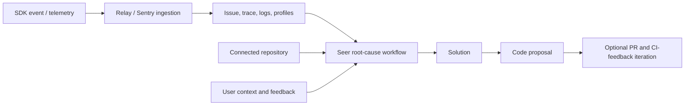
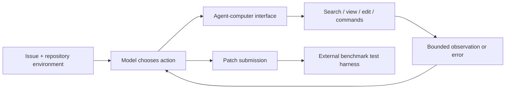
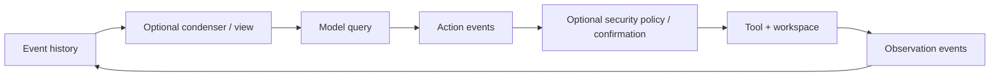

# Milestone 4A — competitor architectures

Research date: 2026-11-05. Scope: public documentation, papers and source; no external repository was executed, and no proprietary service was accessed. **Evidence labels:** `SOURCE` = directly visible source; `DOC` = vendor/project description; `PAPER` = authors' experimental report; `INFERENCE` = our interpretation; `UNKNOWN` = not established by these sources. Confidence refers to the stated finding, not to correctness of an AI diagnosis. Public repository heads inspected: Sentry `3ea934128e16292d34f0fc94127ee94c5c678bdd`, SWE-agent `3ea751c087f32b16e039a2233dd6eefecef325d5`, OpenHands SDK `987eaaa08ae6412eb6fb43f450df5d99d8515e48`; live documentation can change. References are primary sources unless labeled otherwise.

## Sentry Seer / Autofix

**Diagram provenance:** Relay's documented ingestion/forwarding role is in the [Relay repository](https://github.com/getsentry/relay); the issue/telemetry/repository, workflow and optional PR/CI steps are described in [Autofix documentation](https://docs.sentry.io/product/ai-in-sentry/seer/autofix/). This diagram is a public-facing reconstruction, not a claim about internal message flow.

| Finding | Type / confidence | Evidence and limits |
|---|---|---|
| Issue details, tracing data, logs, profiles and connected source repositories are documented inputs; users can add context. | DOC / high for documented capability | [Autofix](https://docs.sentry.io/product/ai-in-sentry/seer/autofix/). Exact event selection, ranking and completeness are unknown. |
| Sentry describes trace-connected telemetry for navigating related data; that relationship links observations but does not prove causation. | DOC / high for vendor description; causal implication is inference | [Sentry engineering blog, 2026-01-27](https://blog.sentry.io/seer-debug-with-ai-at-every-stage-of-development/). The article's code-review section explicitly says that feature was retired; do not treat its historical description as current availability. |
| Root cause → solution → code generation is documented; user feedback and optional PR iteration can use CI failure feedback. | DOC / high | [Autofix workflow](https://docs.sentry.io/product/ai-in-sentry/seer/autofix/) and [issue-fix API](https://docs.sentry.io/api/seer/start-seer-issue-fix/). The API has stopping points. These do not establish that every proposed patch was reproduced and independently tested. |
| Public Sentry endpoint code exposes setup, permissions, trigger/state and publishing boundaries. | SOURCE / high for this file | [`group_ai_autofix.py` at inspected commit](https://github.com/getsentry/sentry/blob/3ea934128e16292d34f0fc94127ee94c5c678bdd/src/sentry/seer/endpoints/group_ai_autofix.py); source has separate publishing-scope checks. It is integration/control-plane evidence, not Seer's private model/tool-selection implementation. |
| Relay is an event forwarding/ingestion component, with optional processing, normalization, filtering and rate limits. | SOURCE/DOC / high | [Relay](https://github.com/getsentry/relay). Relay is not demonstrated to be the Seer reasoning agent. |
| Internal hypothesis search, confidence calibration, precise prompts, model/tool policy, test harness and prevention of false causes are not established. | UNKNOWN / high confidence in the knowledge gap | A Sentry contributor stated in July 2025 that the Seer repository was private ([issue](https://github.com/getsentry/sentry/issues/94850)); this is dated evidence, not proof of present-day licensing of every component. No proprietary behavior is inferred from the public endpoint. |

Product descriptions are claims about supported workflows, not independent measurements of causal correctness. Visibility of supporting data or fixability scores is not proof of entailment. Different settings and permissions affect what actually runs.

## SWE-agent

**Diagram provenance:** the [2024 SWE-agent paper](https://arxiv.org/abs/2405.15793) describes iterative model–environment interaction and benchmark evaluation; the inspected [ACI documentation](https://github.com/SWE-agent/SWE-agent/blob/3ea751c087f32b16e039a2233dd6eefecef325d5/docs/background/aci.md) describes the tools and feedback. An agent *can* execute tests; the diagram does not assert that it always does so.

| Finding | Type / confidence | Evidence and limits |
|---|---|---|
| The ACI offers file viewing, directory search, editing and feedback designed for an LM; the documented historical viewer uses a 100-line window and search summarizes matching files. | SOURCE/DOC / high for inspected ACI description | [ACI source](https://github.com/SWE-agent/SWE-agent/blob/3ea751c087f32b16e039a2233dd6eefecef325d5/docs/background/aci.md). These are historical/design examples, not guaranteed settings in every modern configuration. |
| The model iteratively chooses actions and receives environment output; commands can run tests. | PAPER/DOC / high for described design | [Paper](https://arxiv.org/abs/2405.15793). Generated commands are broader authority than BLACKBOX should grant in this milestone. |
| Edit-time syntax feedback and a separate benchmark test evaluator provide checks. | DOC/PAPER / high for documented checks | [ACI](https://github.com/SWE-agent/SWE-agent/blob/3ea751c087f32b16e039a2233dd6eefecef325d5/docs/background/aci.md), [paper](https://arxiv.org/abs/2405.15793). Syntax and finite tests cannot establish causal truth or safety. |
| The paper's results support ACI design in its particular tasks/models, not 4B BLACKBOX performance. | PAPER / high as a limitation | The paper reports a historical SWE-bench setup and an ablation; tasks, models and harness differ from BLACKBOX. Avoid transferring benchmark percentages. |
| Runtime production telemetry and explicit calibrated causal-hypothesis verification are not established as intrinsic capabilities by these sources. | UNKNOWN / medium | Environment command observations and test output are runtime feedback; that is not the same as trace-connected production telemetry. |

The [repository](https://github.com/SWE-agent/SWE-agent) currently recommends mini-SWE-agent for most new work; the historical paper and ACI remain useful evidence of interface design, not a current-product parity claim.

## OpenHands / Software Agent SDK

**Diagram provenance:** [Agent architecture](https://docs.openhands.dev/sdk/arch/agent), [event model](https://docs.openhands.dev/sdk/arch/events), and [security guide](https://docs.openhands.dev/sdk/guides/security). Configuration determines tool availability, confirmation and environment.

| Finding | Type / confidence | Evidence and limits |
|---|---|---|
| Agent steps read event history, request model actions, dispatch tools and add observations; conversation owns lifecycle and event state. | DOC/SOURCE / high | [Agent documentation](https://docs.openhands.dev/sdk/arch/agent), [agent.py at inspected commit](https://github.com/OpenHands/software-agent-sdk/blob/987eaaa08ae6412eb6fb43f450df5d99d8515e48/openhands-sdk/openhands/sdk/agent/agent.py), [conversation architecture](https://docs.openhands.dev/sdk/arch/conversation). Tool outputs are evidence of tool behavior, not necessarily production runtime. |
| Typed `ActionEvent` and `ObservationEvent` support traceability; optional condensers reduce history for the LLM. | DOC / high | [Events](https://docs.openhands.dev/sdk/arch/events), [condenser](https://docs.openhands.dev/sdk/arch/condenser). A summary can lose facts; retention is not semantic verification. |
| Local workspace uses host subprocesses; remote/container alternatives exist. Confirmation policies include always, never and risk-based choices. | DOC / high | [Workspace](https://docs.openhands.dev/sdk/arch/workspace), [security guide](https://docs.openhands.dev/sdk/guides/security). Isolation and approvals are configuration-dependent, not guaranteed for every deployment. |
| Execution feedback can support testing, but no cited framework mechanism proves every diagnosis or guarantees independent regression tests. | INFERENCE/UNKNOWN / medium | Agent/tool architecture allows execution, but the cited docs do not establish a mandatory independent test for every repair. |

## Synthesis

All three sources describe access to more than one piece of information; SWE-agent and OpenHands expose iterative action–observation loops, while Sentry documents a telemetry-backed issue workflow. None of the cited sources establishes a universal mechanism that proves unrestricted natural-language causation. BLACKBOX should test small, bounded adaptations rather than copy architecture wholesale. Current design proposals and acceptance criteria are in [43_M4A_EXPERIMENT_DESIGNS.md](43_M4A_EXPERIMENT_DESIGNS.md).

### OpenHands repository boundary

The inspected [OpenHands/OpenHands](https://github.com/OpenHands/OpenHands) README describes Agent Canvas as the developer control center; the [Software Agent SDK repository](https://github.com/OpenHands/software-agent-sdk) describes itself as owning the agent, tool, conversation, workspace and server implementations consumed by that client. This is a current README-level distinction, not a claim that every historical OpenHands architecture had the same boundary. The README explicitly warns that its unsandboxed local mode gives the agent host filesystem access; do not infer container confinement from the product name.
